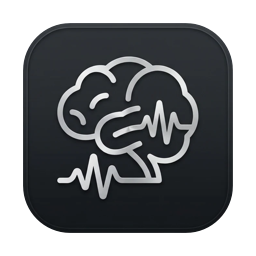

<p align="center">
  
</p>

<h1 align="center">Brain Dump</h1>

<p align="center">
  Speak your morning thoughts. Get to-dos, ideas and notes out the other side.<br>
  A small macOS app that runs entirely on your Mac.
</p>

---

Brain Dump is for the first few minutes of the day: click one button, talk through whatever is in your head, and stop. The app transcribes what you said, pulls out the things worth keeping, and files them where they belong once you approve them.

- **To-dos** go to Apple Reminders, with a due date when you mentioned one.
- **Ideas** and **Thoughts** become markdown notes in a folder you choose.
- **Everything you said** is kept as a dated journal entry.

Speech recognition and analysis both run on-device. Nothing leaves your Mac unless you switch on the optional cloud model.

## How it works

1. **Dump.** Click "What's on your mind?" and talk. A ring counts down your target time (30 seconds to 10 minutes, or off) and cheers you on if you go past it. It never cuts you off.
2. **Review.** Your transcript appears on the left and suggested items appear as cards on the right. Hover a card to see the sentence it came from. Approve, dismiss or rename each one. If something was missed, highlight the text and add it yourself.
3. **Apply.** Approved to-dos are created in Reminders, and ideas and thoughts are saved as notes that link back to the journal entry. Each action can be undone from the summary.
4. **Connect.** When a new idea or thought looks similar to an older note, the app suggests linking them. Approved links are written into both notes as `[[wiki links]]`.

Your notes are plain markdown in `~/BrainDump` (or any folder you pick), organised as `Journal/`, `Ideas/` and `Thoughts/`. Point Obsidian at the same folder and the links and graph work there too. A built-in Library lets you read them without leaving the app.

## Download and run

**Requirements:** an Apple Silicon Mac running macOS 15 or later, and about 1.5 GB of free disk space for the models.

1. Download `BrainDump.zip` from the [latest release](../../releases/latest) and unzip it.
2. Move `BrainDump.app` to your Applications folder.
3. The app is not notarised by Apple, so macOS will refuse to open it the first time. Either:
   - run `xattr -dr com.apple.quarantine /Applications/BrainDump.app` in Terminal, or
   - try to open it, then go to **System Settings › Privacy & Security** and click **Open Anyway**.
4. Open the app and follow the short intro. It asks for microphone access, and for Reminders access if you want to-dos created there.

The first dump downloads two models from Hugging Face: a speech model (about 400 MB) and a small language model (about 730 MB). After that the app works offline.

## Build from source

You need the Xcode Command Line Tools (`xcode-select --install`). Full Xcode is not required.

```sh
git clone https://github.com/aadillyas/brain-dump.git
cd brain-dump
./Scripts/bundle.sh        # builds dist/BrainDump.app and dist/BrainDump.zip
open dist/BrainDump.app
```

Other useful commands:

```sh
swift run BrainDumpCheck                      # unit checks
swift run -c release braindump-eval           # extraction eval on Evals/fixtures.json

# Run the pipeline on a text file without the UI (writes notes, never touches Reminders)
dist/BrainDump.app/Contents/MacOS/BrainDump --process-text dump.txt --notes-root /tmp/notes
```

## Privacy

- Audio is transcribed on your Mac and is not stored.
- The language model runs locally through llama.cpp.
- The only network calls are the one-time model downloads, unless you enable the cloud model in Settings. In that case the transcript text is sent to the Anthropic API using your own key, which is stored in the macOS Keychain.

## How the small model is kept honest

A model small enough to run on an 8 GB laptop makes mistakes, so the app limits what it is allowed to do:

- The transcript is split into short numbered lines and the model only labels each line: skip it, or call it a to-do, idea or thought and give it a title.
- Its output is constrained by a grammar, so it cannot produce anything outside that format.
- It never writes dates. It copies the words you used ("next Tuesday at 9") and a deterministic parser resolves them.
- Note bodies are your own words, quoted verbatim. The title is the only text the model writes.
- Nothing is created until you approve it.

## Status and known limits

This is an early personal project. It works end to end, but expect rough edges:

- The model over-extracts and sometimes picks the wrong kind. Current numbers are in [`Evals/RESULTS.md`](Evals/RESULTS.md).
- At most one item is found per sentence; use highlight-to-add for the rest.
- Some date phrases are not understood yet ("before ten", "end of the month").
- English only.
- Developed and tested on a single M2 MacBook.

## Project layout

| Path | What it is |
|---|---|
| `Sources/BrainDump` | The SwiftUI app |
| `Sources/BrainDumpCore` | Models, sentence splitting, date parsing, notes store, connectors |
| `Sources/BrainDumpLLM` | Local and cloud model providers, prompts, extractor |
| `Sources/braindump-eval`, `Evals/` | Extraction eval and fixtures |
| `Sources/braindump-check` | Unit checks as a plain executable |
| `Scripts/` | App bundling and icon generation |

## Credits

- [FluidAudio](https://github.com/FluidInference/FluidAudio) for on-device speech recognition (Apache 2.0)
- [llama.cpp](https://github.com/ggml-org/llama.cpp) for running the language model (MIT)
- [LFM2.5](https://huggingface.co/LiquidAI) by Liquid AI, the default language model; see its model card for licence terms
- Inspired by [Freewrite](https://github.com/farzaa/freewrite) and [FluidVoice](https://github.com/altic-dev/FluidVoice)

## Licence

[MIT](LICENSE)
